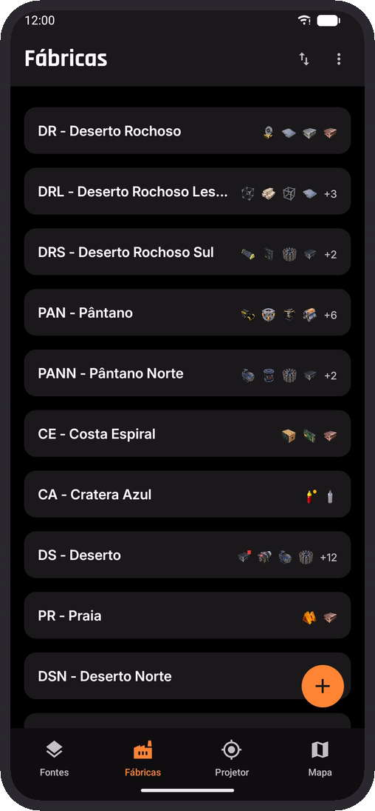
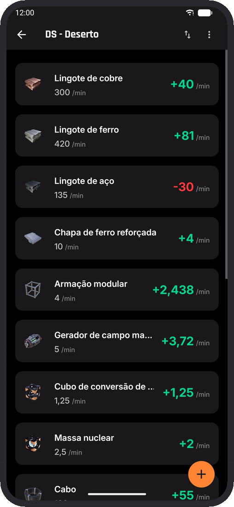
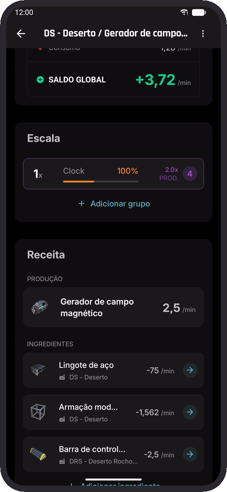
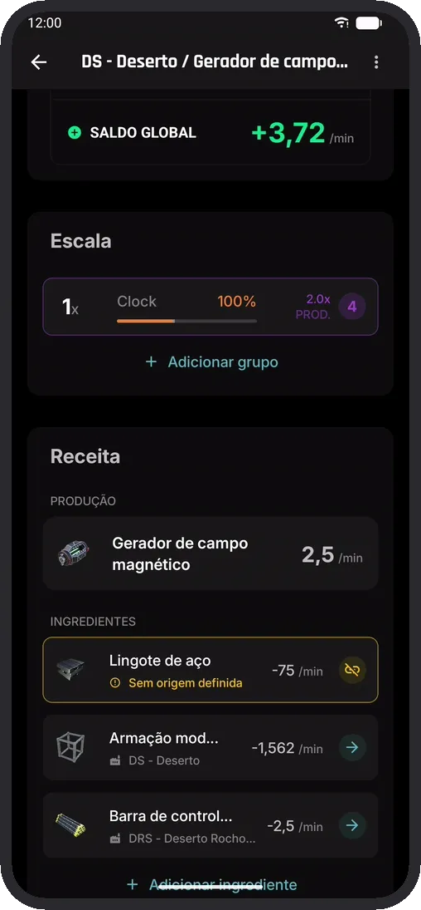
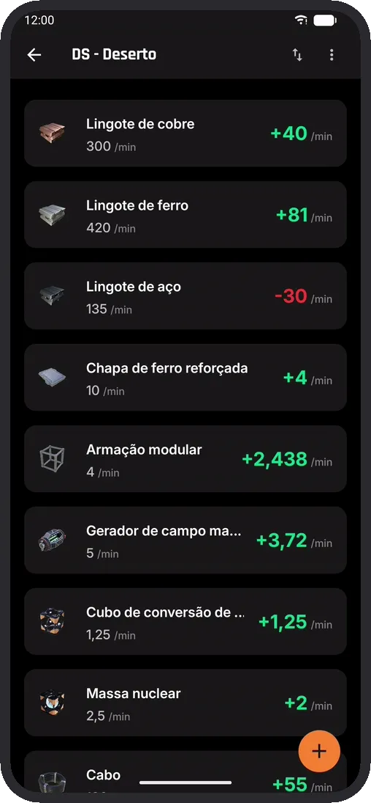
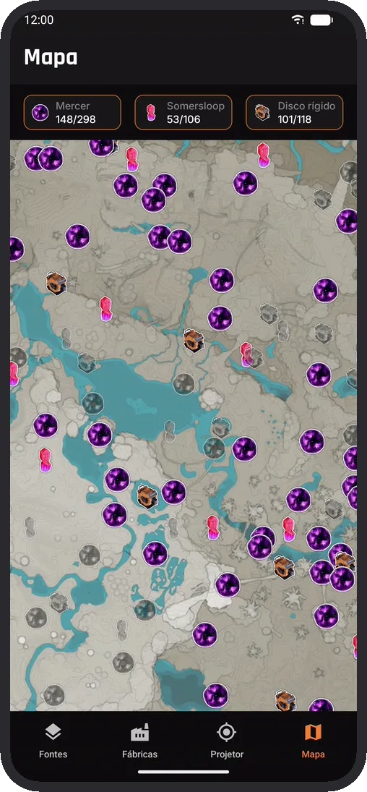

# sAPPisfactory

A mobile factory planner for [Satisfactory](https://www.satisfactorygame.com/), built with React Native and Expo.

I built it to solve a problem I had in my own save: dozens of production lines spread across several factories, and no way to know what was in surplus or deficit without redoing the math by hand every time I changed a machine. I used it during roughly two months of real gameplay, through the endgame.

It is a personal tool that I turned into a portfolio project. It was never published to a store and it is not meant for a general audience.

> **Note:** the whole UI is in Portuguese (pt-BR), including the number format. The screenshots and the labels quoted below reflect that.

---

## Screenshots

All captures use the data from my real save, the one I played with. Only a few links and machine counts were changed so that the warning states show up, since by the end of the game everything was balanced.

<table>
  <tr>
    <td align="center" width="33%"></td>
    <td align="center" width="33%"></td>
    <td align="center" width="33%"></td>
  </tr>
  <tr>
    <td align="center"><sub>Factories, with a status dot per production line: red for a deficit, yellow for an input with no source.</sub></td>
    <td align="center"><sub>A factory's lines, each with its output and its global balance.</sub></td>
    <td align="center"><sub>Scale with 4 somersloops (2.0x output) and a recipe pulling inputs from two factories.</sub></td>
  </tr>
</table>

### In motion

<table>
  <tr>
    <td align="center" width="50%"></td>
    <td align="center" width="50%"></td>
  </tr>
  <tr>
    <td align="center"><sub><b>Linking a source.</b> Steel has no source yet. The sheet lists every steel line in the network with its live balance. Linking it to the Desert factory pushes that line to -30/min.</sub></td>
    <td align="center"><sub><b>Fixing it.</b> One more foundry and the balance goes from -30 to +15/min, recomputed across the whole network as the value changes.</sub></td>
  </tr>
  <tr>
    <td align="center"></td>
    <td align="center"></td>
  </tr>
  <tr>
    <td align="center"><sub><b>Goal projector.</b> Raising the magnetic field generator from 5 to 7/min shows every line upstream that would run short, across two factories.</sub></td>
    <td align="center"><sub><b>Offline map.</b> Filter by collectible type and mark one as collected. The counter updates right away.</sub></td>
  </tr>
</table>

---

## Features

### Factories and production lines
- Factories and production lines organized in scrollable lists
- Reorder mode with drag and drop, available for factories, production lines and global sources
- Swipe to delete with a confirmation dialog
- Each factory card previews its production lines with status dots (red for a resource deficit, yellow for an input with no source linked)

### Production line detail
Each production line has three sections:

**Summary.** Total production rate, consumption per input, and the global balance of that item across the whole network.

**Scale.** A list of machine groups. Each group has a module count (how many machines), a clock speed from 0% to 250%, and a somersloop count from 0 to 4. Somersloops add output without changing input consumption, and are drawn in the alien color.

**Recipe.** The base recipe: output item and rate, plus the input ingredients. Each input can be linked to a source, which is what lets the app compute flows across the network.

### Recipe replication
If you create a production line for an item that is already produced somewhere else, the app detects it and offers to copy the existing recipe (output rate and all inputs) instead of typing everything again. Useful when you scale a product into a second factory.

### Global balance
The reactive layer the rest of the app is built on. For every production line and global source it computes:
- Total production (base rate x clock speed x module count, plus somersloops on the output side)
- Total consumption from every input linked to it
- The resulting balance

It runs as a single RxJS stream combining four WatermelonDB queries (global sources, production lines, inputs and scale groups). Any write to any of those recomputes the whole picture, so every screen stays in sync without manual state management.

### Source association
An input can be linked to a global source or to another production line. The association sheet shows the live balance of each candidate, so you can see which ones actually have surplus to give before linking.

### Global sources
A tab for raw inputs (miners, extractors) with their rate per minute. They feed the global balance and can be linked by any production line input.

### Goal projector
Pick a production line, type a target output, and the app simulates what it takes to get there. Details in the section below.

### Data export
The menu on the factories screen exports every table as a JSON file through the system share sheet. It is the only way to get data off the device, since there is no sync.

### Interactive map
A Leaflet map of the Satisfactory world inside a WebView, working fully offline:
- Mercer Spheres, Somersloops and Hard Drives as filterable markers
- A counter per type (for example "12/30 collected")
- Tap a marker to toggle its collected state, persisted to the local database
- Map tiles ship as a zip asset and are extracted to the device on first launch

---

## Goal projector

This is the most interesting part of the codebase, so it gets its own section.

Given a target rate for a production line, `projectGoal` walks the dependency tree and reports, for every node, the current balance, how much is being requested from it, and the balance it would end up with.

Two things make it less trivial than it looks:

**It reasons in batches, not ratios.** You cannot produce 1.37 of a machine. The service computes how many whole recipe batches cover the gap (`ceilDiv(gap, outputBaseRate)`) and propagates the input demand from that batch count. So a request for a bit more output can round up into a visibly larger demand upstream, which is what actually happens in game. It started out as a plain ratio and was rewritten once I saw the numbers not matching my factory.

**Demand accumulates across branches.** A source feeding three different lines gets all three demands summed against its balance, not evaluated three times in isolation. That is tracked in a shared `simulationState.demandedTotal` carried through the recursion, and it is the difference between a projection that looks fine and one that is actually achievable.

On top of that it detects cycles (a line that ends up depending on itself), treats global sources as leaf nodes, and flags inputs with no source linked as warnings instead of silently assuming they are free.

The result is a tree with a status: `PRONTO PARA PRODUZIR`, `GARGALOS ENCONTRADOS`, `META JÁ ATENDIDA` or `META ATENDIDA COM GARGALOS`. Every node is tappable and takes you to the production line or global source causing the problem.

---

## Tests

```bash
npm test
```

The goal projector has 14 unit tests in `src/services/goal-projector/__tests__`, covering demand propagation from the root, children with enough balance, deficits, cycles, global sources, unlinked inputs, batch math and cumulative demand across shared sources.

They exist because every one of them started as a wrong number I hit while using the app.

---

## About the process

Worth being upfront about this, since it is a portfolio project.

I wrote the app by hand, using AI as an assistant the way I would use documentation or autocomplete. The projector is the exception: I had the idea and the model of how it should behave, but I delegated the implementation.

What I did there was a different kind of work. I ran it against my real save, found the cases where the output did not match reality (cycles, sources shared between lines, rounding by batch instead of by ratio), and kept iterating until it was correct. The tests listed above came out of that loop, one per bug.

I am documenting it this way because the interesting part was not typing the recursion, it was knowing the result was wrong and why.

---

## Tech stack

| Layer | Technology |
|---|---|
| Framework | React Native + Expo SDK 54 |
| Navigation | Expo Router (file based) |
| Database | WatermelonDB (SQLite, offline first, reactive) |
| Reactive streams | RxJS (`combineLatest` for the global balance) |
| Styling | NativeWind (Tailwind for React Native) |
| Bottom sheets | @gorhom/bottom-sheet |
| List reordering | react-native-draggable-flatlist |
| Forms and keyboard | react-native-keyboard-controller |
| Images | expo-image |
| Haptics | expo-haptics |
| Fonts | expo-font (Inter, Rajdhani) |
| Map | Leaflet in react-native-webview |
| Map tiles | react-native-zip-archive (offline bundle) |
| Animations | react-native-reanimated |
| Tests | Jest + ts-jest |

---

## Architecture notes

**Reactive data layer.** Components subscribe to WatermelonDB observables through the `withObservables()` HOC. A write propagates to every subscribed component with no state management in between.

**Writes go through services.** Components never write to the database directly. Every mutation lives in `src/services` (`factoryService`, `productionLineService`, `scaleGroupService`, `reorderService`, and so on) inside a `database.write()` transaction.

**Balance as a derived stream.** `useGlobalBalance` combines the four relevant queries into one stream and exposes the result through a context, so any screen can ask for the balance of a line or source without querying anything itself.

**Offline map.** The map tiles ship as a zip asset and are extracted to the device document directory on first launch. The WebView loads a local HTML page, and the React Native side injects the collectibles and listens for toggles over `postMessage`.

**Versioned schema.** The database is on schema version 2, with a migration adding the `position` columns used by the reorder mode.

---

## Project structure

```
app/
  _layout.tsx
  (tabs)/
    index.tsx              # Factories list
    global-sources.tsx     # Global sources
    projector.tsx          # Goal projector
    map.tsx                # Interactive map
  factory/[id].tsx         # Factory detail
  production-line/[id].tsx # Production line detail

assets/                    # app icons, tiles.zip, index.html (Leaflet page)

src/
  assets/                  # item icons, collectible icons, fonts
  components/
    ui/                    # design system (Button, Card, Input, BottomSheet, ...)
    features/              # feature components, by domain
  data/
    item.ts                # static item database (200+ items)
    collectibles.json      # map collectible positions
  db/
    model/                 # WatermelonDB models
    schema.ts
    migrations.ts
  hooks/
    useGlobalBalance.tsx
  services/
    global-balance/        # balance computation
    goal-projector/        # simulation tree + tests
  theme/                   # colors and gradients
  utils/                   # pt-BR number parsing, typography
```

---

## Running locally

WatermelonDB needs a native build, so Expo Go will not work.

```bash
npm install
expo run:android   # or: expo run:ios
```

After the first native build, JS only changes run with:

```bash
npm start
```

### Demo data

Setting `EXPO_PUBLIC_DEMO_SEED=1` loads my real save into an empty database on first launch (`src/data/demo/demoSave.json`, with the small adjustments in `src/services/demoTweaks.ts`). It is how the screenshots above were made.

```bash
EXPO_PUBLIC_DEMO_SEED=1 npx expo run:android --variant release
```

The seed only runs when the database has no factories, so clear the app data to reload it.

---

## Scope and limitations

Things this app deliberately does not do, since it was built for one player and one save:

- No account, no sync, no automatic backup. Everything lives in the local SQLite database on the device, and the JSON export is manual.
- No official recipe database. The item catalog and icons are bundled, but rates are typed by hand, which is what let me plan around alternate recipes and partial setups.
- Portuguese only, with no i18n layer.
- Android only in practice. The iOS target exists but was never built or tested.
